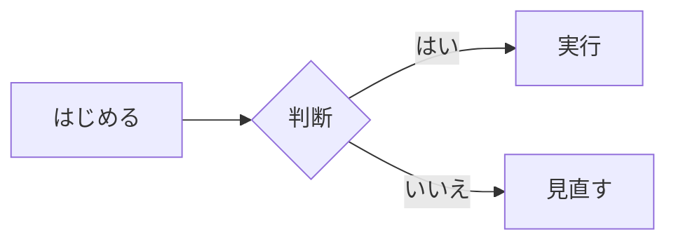

# slides.md の書き方

普通の Markdown に、スライド用の決まりごとをいくつか足しただけです。
（実装は `src/core/parse.js` と `src/core/render.js`。記法を変えたらこのファイルも直すこと）

## エディタ（「原稿」タブ）

書いた Markdown はその場で整形されます（Obsidian のライブプレビューと同じ考え方）。

- `#` や `**`、リンクの URL などの記号は、**カーソルのある行（範囲）にだけ**表示されます
- 画像・mermaid の図・表は、その場で描画されます。カーソルを入れる（クリックする）と元の記法に戻ります
- `---` の区切りは「スライド N・タイトル・レイアウト」の見出し線、`???` は「発表者ノート」、`|||` は「カラム区切り」として表示されます
- リストの行で Enter を押すと、次の項目の `- ` や `2. ` が自動で入ります
- `Ctrl+B` 太字 / `Ctrl+I` 斜体 / `Ctrl+Z` 元に戻す / `Ctrl+Y` やり直し / `Ctrl+Enter` 発表
- 2 段目の書式ボタンでも、見出し・太字・斜体・取り消し線・マーカー・コード・リンク・箇条書き・番号付き・引用を付けられます
  （Markdown の記号を覚えていなくても書けます。もう一度押すと外れます）
- 表はセルに直接入力できます。`Tab` で次のセル、`Enter` で下のセル（最後の行なら行を追加）。
  表の上のボタンで行・列の追加 / 削除、列の左・中央・右揃え。`<>` ボタンで Markdown の記法に戻して編集できます
- 右上の「ソース」に切り替えると、整形をやめて Markdown をそのまま表示します

## 基本

```markdown
---
title: 発表タイトル
author: 名前
date: 2026-11-14
---

# 表紙のタイトル

サブタイトル

---

## 2 枚目の見出し

- 箇条書き
- **強調** / *アクセント色* / `コード` / [リンク](https://example.com)
```

| 書き方 | 意味 |
| --- | --- |
| 先頭の `---` 〜 `---` | デッキ情報。`title` `author` `date` `lang` が使える（フッターの `{title}` などに入る） |
| 空行 + `---` + 空行 | スライドの区切り（**直前が空行**のときだけ。本文中の横線は `***` を使う） |
| `???` または `Note:` だけの行 | そこから下はそのスライドの発表者ノート（発表者ビューにだけ出る） |
| `\|\|\|` だけの行 | カラムの区切り（左右に並ぶ） |
| `::: columns` 〜 `:::` | カラムにする範囲（囲みの外は全幅）。`::: rows` で縦に、`::: grid` で 2 列の格子に並べる |
| `<!-- id: 名前 -->` | スライドの ID を固定する。GUI で個別設定をすると自動で入る |

`---` / `???` / `|||` は、コードブロック（```` ``` ````）の中では無視されます。

## 画像

```markdown


{width=60%}
{height=300 .shadow}
```

- エディタ・プレビュー・サムネイルにドラッグ＆ドロップ / 貼り付けすると、`assets/` に保存してこの記法を挿入します
  （プレビューやサムネイルに落とすとそのスライドの末尾、エディタに落とすと落とした段落の直後に入ります）。
  長辺が 2560px を超える写真（JPEG / WebP）は、保存するときに自動で縮小します
- `{…}` で `width` / `height`（数値なら px）と、クラス `.shadow`（影）`.plain`（角丸なし）`.round`（円形）を指定できます。
  プレビューやエディタで画像の角をドラッグしたり、ツールバーの「影」等を押したりすると、この `{…}` が自動で書き換わります。
  なお、横に並べた画像・全面に敷いた画像は枠いっぱいに表示するので、`{width}` は使われません
- `width` の % は「本文の幅」に対する割合です（スライドでは本文やカラムの幅、資料では紙面の幅）
- 段落に画像だけを書くと「図」として大きく表示されます。並べて書くと横に並びます
- 本文と画像 1 枚のスライドは、自動で「画像：右」レイアウトになります
- HTML に書き出すとき、画像は既定で HTML に埋め込まれます（data URI。1 ファイルで完結）。
  書き出しメニューの「HTML に画像を埋め込む」をオフにすると、画像（と mermaid）を「<HTML名>_files/」フォルダに置いて参照します。
  どちらもネット接続は不要です（オフラインで表示できます）

## カラムと「箱」

```markdown
## 機能紹介

### 新規機能①

図面自動作成

|||

### 新規機能②

見積自動生成
```

`|||` で区切ると左右に並びます。この書き方では、スライドの本文全体がカラムになります。

スライドの一部分だけをカラムにしたいときは、`::: columns` と `:::` で囲みます。囲みの前後に書いた文章は、カラムの上下に全幅で入ります。

```markdown
## 3 つの工程

工程は次のとおりです。

::: columns

### 書く
Markdown で

|||

### 整える
GUI で

:::

この行はカラムの下に全幅で入ります。
```

### 縦に並べる・格子にする

囲みの最初の行を `::: rows` にすると上下に、`::: grid` にすると 2 列の格子（4 つなら 2 × 2）に並びます。区切りは同じく `|||` です。

```markdown
::: rows

### 第 1 段階
要件を洗い出す

|||

### 第 2 段階
試作して確かめる

:::
```

並べ方は「このスライド」→「カラムの囲み」の「並べ方」（自動 / 横 / 縦 / 格子）や、デッキ全体の「全体」→「カラムの囲み」→「並べ方」でも選べます。
優先順位は「このスライドの設定 > 原稿の `::: rows` / `::: grid` > 全体の設定」です。格子で数が奇数のときは、最後の 1 つが横いっぱいになります。

「段階表示（クリックごとに 1 項目）」にしたスライドでは、カラムは 1 列（1 つの箱）ずつ現れます。

「このスライド」→「カラムの囲み」で、各カラムを **枠線 / 塗り / カード** の箱にできます。
デッキ全体の既定（囲み・角丸・カラム 1〜4 の色・文字の横位置 / 縦位置・塗りの上の文字色）は「全体」→「カラムの囲み」で決められ、スライドごとの設定が優先されます。
文字の縦位置は「上詰め / 中央 / 下詰め」から選べます（自動のときは、箱なら中央・箱なしなら上詰め）。
箱にすると、先頭の小見出しはラベル風に上へ、短い本文は大きく中央に置かれます。
カラムの中の文字が多くて収まらないときは、カラムの文字だけを自動で小さくして収めます（列が 3 つ以上のときは少し小さめから始めます）。

## 箇条書きの記号

「全体」→「形・レイアウト」→「箇条書きの記号」で ●・–・→・✓・■ から選べるほか、「好きな記号…」を選ぶと
1 段目・2 段目以降の記号を自由に決められます（◆ ★ ▶ ✔ ※ や絵文字など、ボタンから選ぶか直接入力）。

## 図形（工程図など）

原稿ツールバーの「図形」を押すと図形エディタが開きます。四角・角丸・円・ひし形・平行四辺形・六角形・シェブロン・ホームベース（工程図向け）・
矢印・三角・円柱・書類・テキストを置き、矢印線 / カギ線でつなげます（図形にマウスを乗せると出る ● から、別の図形へドラッグ）。
ダブルクリックで文字、右のパネルで色・線・文字の大きさ・揃え・重なり順・整列を変えられます。

保存すると `assets/<名前>.diagram.svg` になり、原稿には画像として入ります（``）。
大きさや置き場所は、ふつうの画像と同じようにプレビュー上で変えられます。図をダブルクリックすると、図形エディタで編集し直せます。
ファイルは普通の SVG なので、ほかのソフトでも画像として開けます（編集用のデータを SVG の中に入れてあります）。

## 図（mermaid）

````markdown

````

フローチャート・シーケンス図・ガントチャートなど、[mermaid](https://mermaid.js.org/) の記法がそのまま使えます。
色はテーマに合わせて自動で決まります。図を描く仕組み（mermaid）は書き出した HTML に同梱されるので、オフラインでも表示できます。
ただし mermaid のアイコン記法（`fa:fa-…`）はネットからアイコンを読み込むため、オフラインではアイコンだけ表示されません。

## コード

````markdown
```js
console.log("hello");
```
````

言語名を付けるとシンタックスハイライトされます（highlight.js）。色はテーマのアクセント色から作られます。

## レイアウトの自動判定

レイアウトは内容から自動で決まり、右パネル「このスライド」でいつでも変えられます。

| 内容 | 自動で選ばれるレイアウト |
| --- | --- |
| `#` 見出し + 短い文 | タイトル |
| `##` 見出しだけ | セクション |
| `\|\|\|` がある | カラム |
| 引用（`>`）だけ | 引用 |
| 本文 + 画像 1 枚 | 画像：右 |
| 見出しなしの短い文だけ | 中央寄せ |
| それ以外 | 標準 |

## はみ出したとき

文字が多くてスライドに収まらないときは、自動で文字を小さくして収めます（最小 50%）。
それでも厳しいときはスライドを分けましょう。

## 資料（読み物）として書き出す

「書き出し」→「資料」を選ぶと、スライドの区切りをなくして 1 本の文書（A4 縦）にまとめます。
「書き出し」→「資料 → プレビュー」で、書き出す前に見た目を確認できます。カラムは横並び（箱の設定もそのまま）、
発表者ノートは「資料に発表者ノートも載せる」をオンにしたときだけ、補足として載ります。

## Office 形式に書き出す

「書き出し」メニューから、次の形式でも書き出せます。どれも書き出したあとに文字や図形を編集できます。

| 形式 | 中身 |
| --- | --- |
| PowerPoint（.pptx）/ OpenDocument プレゼンテーション（.odp） | スライド。文字はテキストボックス、箱は図形、表は表、図形エディタの図は図形のまま。発表者ノートも入る。mermaid の図は画像 |
| Word（.docx）/ OpenDocument テキスト（.odt） | 原稿を資料（読み物）形式にした文書。見出し・リスト・表・コード・画像は Word / Writer のスタイルとして入る |

スライドは、プレビューに表示されているとおりの位置・色・大きさを測って作るので、見た目はほぼ同じになります
（フォントの違いで、折り返しの位置が少し変わることがあります）。.odp / .odt は LibreOffice・Word / PowerPoint・Google ドキュメントで開けます。

## HTML

Markdown の中に、文字の飾りに使う HTML のタグを書けます（`<kbd>Ctrl</kbd>`、`<small>注釈</small>`、`<mark>強調</mark>`、`<br>` など）。

原稿は .kami などで他の人から受け取ることもあるので、安全のため、使える HTML は次のタグに限っています。属性は `class` だけが使えます。

`b` `strong` `i` `em` `u` `s` `del` `ins` `mark` `small` `sub` `sup` `kbd` `code` `samp` `var` `abbr` `q` `cite` `span` `div` `p` `br` `hr`
`ruby` `rt` `rp` `details` `summary` `blockquote` `ul` `ol` `li` `dl` `dt` `dd` `table` `thead` `tbody` `tr` `th` `td` `figure` `figcaption` `center`

- これ以外のタグ（`<script>` `` `<iframe>` `<style>` `<a>` など）は、実行されずに文字のまま表示されます。画像は ``、リンクは `[文字](https://…)` で書いてください
- `onclick` などの属性、`<!-- -->` のコメントは取り除かれます
- 画像はプロジェクトのフォルダの中のものだけが使えます（`../` やほかの場所を指す画像は表示・書き出しされません）
- ネット上の画像（`https://…`）は、アプリと書き出した HTML では読み込みません（開いただけで外部と通信しないように）。手元に保存してから、ドラッグ＆ドロップで入れてください
